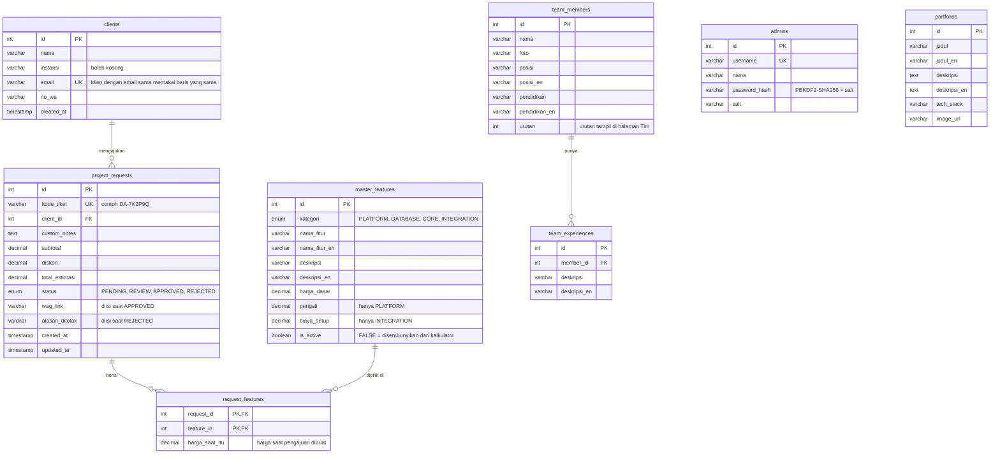

# Diagram database

Diagram ini mengikuti isi [schema.sql](schema.sql). Kalau schema berubah, ubah juga diagram ini.

Diagram bisa dilihat langsung di GitHub, atau di VS Code lewat Markdown Preview (`Ctrl+Shift+V`).

## Schema sekarang

- `admins` tidak berelasi dengan tabel lain. Tabel ini hanya dipakai untuk login admin.
- `portfolios` juga berdiri sendiri. Isinya ditampilkan di beranda.
- `team_members` dan `team_experiences` dipakai halaman Tim. Pengalaman ikut terhapus kalau anggotanya dihapus (`ON DELETE CASCADE`).
- Kolom berakhiran `_en` berisi teks bahasa Inggris. Kalau kosong, aplikasi memakai versi Indonesia.
- `request_features` adalah tabel penghubung many-to-many antara pengajuan dan fitur. Primary key-nya gabungan `request_id` dan `feature_id`, jadi satu fitur hanya bisa dipilih sekali per pengajuan.
